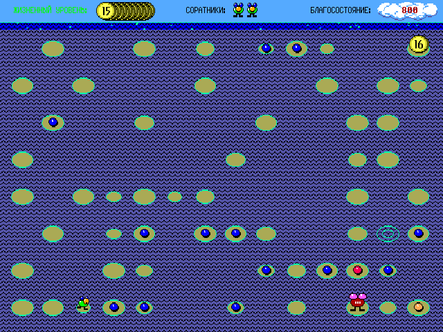
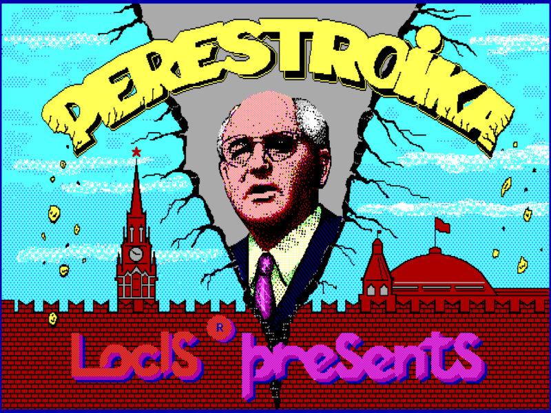
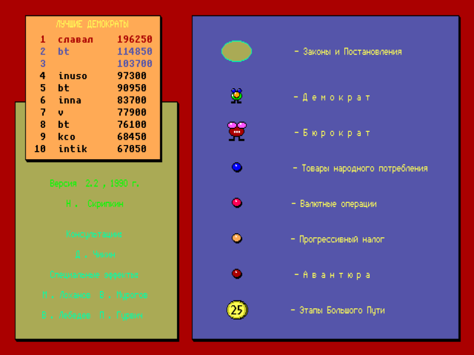
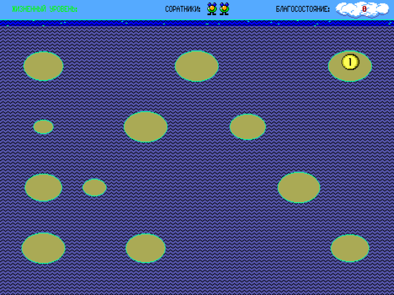
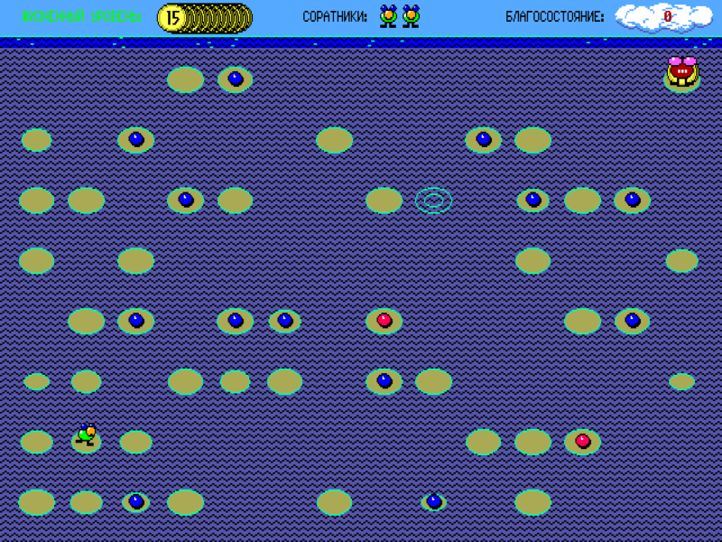
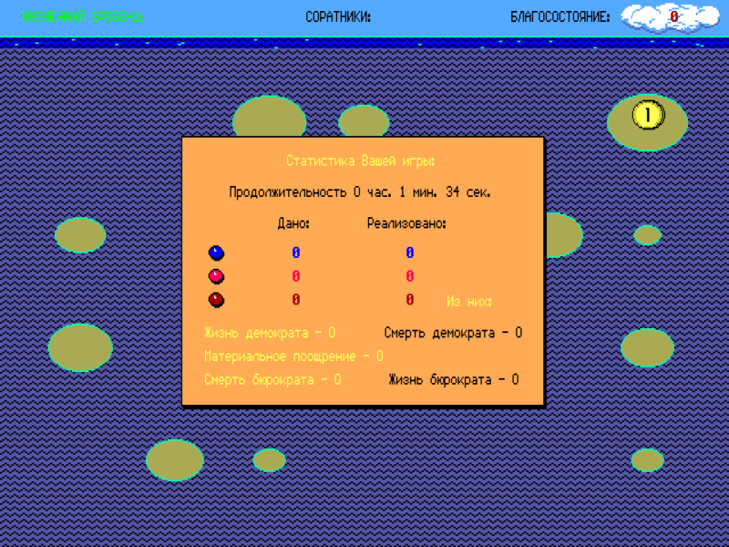
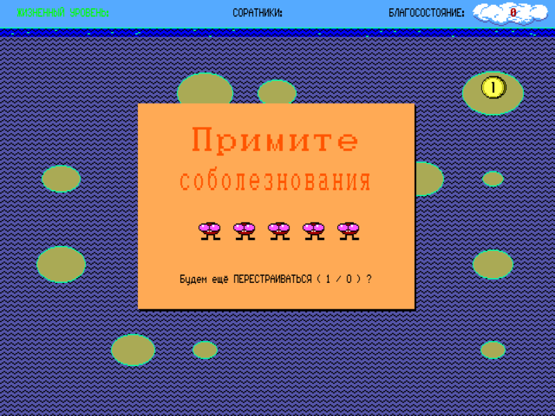

# Перестройка

Аркадная игра Никиты Скрипкина (Locis, 1990). Демократ пробирается по
болоту «Законов и Постановлений» к очередному «Этапу Большого Пути».
По дороге он собирает товары народного потребления, ввязывается в авантюры
и уходит от Бюрократов.

Работает на Linux, macOS и Windows.



| | |
|---|---|
|  |  |
|  |  |
|  |  |

## Сборка и запуск

Нужен Go 1.25 или новее.

```sh
go build -o perestroika .   # perestroika.exe на Windows
./perestroika
```

`make dist` собирает версии для Linux, macOS и Windows (amd64 и arm64) в
каталог `dist/`. Сборка возможна на любой из этих систем для любой другой.

На Linux нужны OpenGL (Mesa) и ALSA (`libasound`). В настольных
дистрибутивах они обычно уже установлены.

## Файл данных

Графика и звук игры хранятся в файле `TOPPLER.DAT` из «Перестройки»
1990 года (версия 2.2). В комплект он не входит. Игра ищет его:

- рядом с программой;
- в текущем каталоге;
- в каталоге настроек игры (см. ниже).

Регистр букв в имени не важен. Если файл не найден, игра откроет окно с
подсказкой: тогда перетащите `TOPPLER.DAT` (или папку с ним) прямо в это
окно, и игра скопирует его в каталог настроек. Путь можно указать и явно:
`./perestroika -dat путь/TOPPLER.DAT`.

## Управление

| Клавиша | Действие |
|---|---|
| Стрелки, цифровой блок 8/4/6/2 | прыжок на соседний лист |
| Esc | пауза (показывается таблица рекордов; любая клавиша — продолжить) |
| 1 / 0 | ответ на вопрос «Будем ещё ПЕРЕСТРАИВАТЬСЯ?» |
| F5 / F6 | меньше / больше задержка картинки под звук |
| F7 / F8 / F9 | медленнее / быстрее / обычная скорость |
| F11 или Alt+Enter | полноэкранный режим |

Звуковую заставку можно прервать любой клавишей.

Если звук отстаёт от картинки (так бывает с Bluetooth-наушниками и
колонками), подберите задержку клавишами F5/F6, например на финальном
танце Бюрократов: шаг — 20 мс, значение видно в заголовке окна и
запоминается.

## Правила

Демократ прыгает по листьям («Законы и Постановления») с нижнего левого
листа к монете «Этапа Большого Пути» в верхнем правом углу. Листья
уменьшаются, тонут и через какое-то время всплывают снова. Кто стоит на
утонувшем листе, тонет вместе с ним.

- «Товары народного потребления» (синий шарик): +50 × номер этапа.
- «Валютные операции» (розовый): +1000 × этап.
- «Прогрессивный налог» (оранжевый): −250 × этап. Бюрократы превращают в
  налог товары, по которым проходят.
- «Авантюра» (тёмно-красный): случайный исход. Бывает дополнительная жизнь,
  гибель, премия +2000 × этап, а также появление или исчезновение Бюрократа.
- Бюрократы преследуют Демократа. Если лист утонет под Бюрократом, тот
  тонет (+1000) и оставляет после себя «Авантюру».
- За пройденный этап начисляется 100 × (число столбцов − 1). Дополнительные
  жизни даются за 10 000, 30 000, 70 000… очков, всего жизней не больше шести.
- Этапов 25. Поле растёт с 7×4 до 14×8 листьев. С 10-го этапа монета может
  перепрыгнуть в угол, противоположный Демократу. С 15-го появляется второй
  Бюрократ, с 20-го первый всегда возвращается.

## Параметры командной строки

| Флаг | Назначение |
|---|---|
| `-dat путь` | файл данных `TOPPLER.DAT` |
| `-speed 1.0` | скорость игры (больше — быстрее) |
| `-fullscreen` | запуск в полноэкранном режиме |
| `-volume 0.7` | громкость 0…1 |
| `-audio-delay мс` | задержка картинки под звук (по умолчанию — сохранённая) |
| `-scores путь` | файл таблицы рекордов |

## Каталог настроек

Таблица рекордов (`hiscores.dat`), настройки (`settings.txt`) и
перетащенный в окно `TOPPLER.DAT` хранятся в каталоге настроек игры:

- Linux: `~/.config/perestroika/`
- macOS: `~/Library/Application Support/perestroika/`
- Windows: `%AppData%\perestroika\`

## Авторы

Автор игры — Н. Скрипкин. Консультации — Д. Чикин. Специальные эффекты —
М. Лоханов, В. Мурогов, В. Лебедев, П. Гурвич. Музыкальный проигрыватель —
В. Н. Мурогов. Locis, Москва, 1990.

## Лицензия

Исходный код распространяется по лицензии MIT, текст — в файле
[LICENSE](LICENSE).

Файл данных `TOPPLER.DAT` в проект не входит. Права на графику, звук и
шрифт игры принадлежат её авторам (© 1990 Н. Скрипкин, Locis), лицензия MIT
на них не распространяется. Шрифт 8×8 основан на
[unscii-8](http://viznut.fi/unscii/), который находится в общественном
достоянии.
